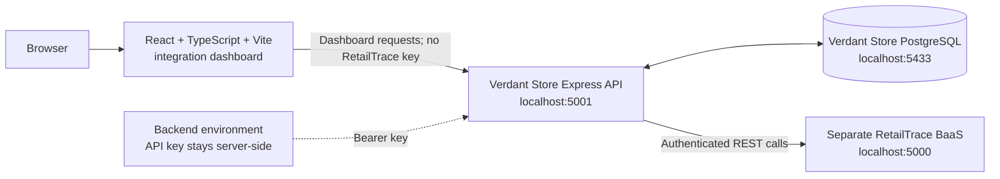

# Verdant Store

Verdant Store is a fictional organic skincare retailer used to demonstrate how a
business can keep its own e-commerce data while using the separate RetailTrace
Business-as-a-Service (BaaS) application for traceability records and
blockchain-backed verification.

The project is being built in stages. Its React frontend is an integration
dashboard for the existing business backend; it is not yet a full storefront.
The backend and the dashboard communicate through Verdant Store's Express API.

## Project status

| Area | Status |
|---|---|
| React + TypeScript + Vite integration dashboard | Implemented and browser-checked; product, cart, and checkout flows are not implemented |
| Express backend and health endpoint | Implemented and tested |
| PostgreSQL Docker Compose service | Implemented and tested |
| Prisma models, initial migration, and seed data | Implemented and tested |
| RetailTrace API client and server-side authentication | Implemented and tested against the live local service |
| Supplier and Product schema initialization | Implemented and live-tested |
| Order multiple-reference schema initialization | Implemented; live version initialization remains unverified because RetailTrace was unavailable |
| Supplier and Product synchronization services | Implemented and live-tested |
| Order synchronization service | Implemented and tested with injected RetailTrace responses; live submission remains unverified |
| Failed synchronization and retry | Implemented; successful retry behavior is covered by tests, and an unavailable-upstream retry was exercised live |
| Record verification | Implemented and live-tested |
| Supplier create/list/detail API and automatic synchronization | Implemented and API-tested |
| Product create/list/detail API and automatic synchronization | Implemented and API-tested |
| Order create/list/detail API and multiple-Product synchronization | Implemented; automated API and sync tests pass |
| RetailTrace multiple-reference support | Implemented in the separate RetailTrace project; backend tests, typecheck/build, frontend build, and lint passed |
| Order record synchronization | Implemented with a RetailTrace `products` multiple-reference field |
| Dashboard integration with the Verdant Store API | Implemented and browser-checked; RetailTrace credentials remain backend-only |
| Backend automated tests | Supplier, Product, and Order API plus sync tests implemented and passing |

`SYNCED` means RetailTrace accepted the record and returned a record ID. It does
not by itself mean the blockchain transaction has been confirmed; use the
verification endpoint to check that separately.

## Business scenario

Verdant Store sells fictional organic skincare. It buys products from suppliers
such as Alpine Herb Collective in Switzerland and Botanical Coast Labs in New
Zealand. The business needs normal e-commerce data—suppliers, stock, orders, and
order items—in its own database. It also wants to publish selected supplier and
product facts to RetailTrace so they can be independently verified.

## Architecture



### Why PostgreSQL and RetailTrace are both used

PostgreSQL is the business application's operational database. It stores the
current Supplier, Product, Order, and OrderItem data that Verdant Store needs to
run its own business. Prisma provides typed access to those tables and manages
their migrations.

RetailTrace is an additional service, not a replacement for PostgreSQL. It
registers business-defined schemas, accepts selected business records, and
provides a blockchain-backed verification operation. The business backend
decides what to submit and keeps its own data and local-to-RetailTrace mapping.
This keeps the shop's operational database under the business's control while
adding an external traceability proof.

The browser does not call RetailTrace directly. The Express backend calls the
RetailTrace REST API with a server-side bearer API key. The key is never placed
in a frontend bundle or returned by a Verdant Store endpoint.

### What a reference means

The two systems have separate ID spaces:

- PostgreSQL uses local primary keys, such as the seeded
  `supplier-alpine-herb`.
- RetailTrace returns its own record IDs (24-character hexadecimal IDs in the
  live service).

When a Product is published, its RetailTrace `supplierId` field contains the
Supplier's **RetailTrace record ID**, not the PostgreSQL `supplierId` foreign
key. `RetailTraceSync` stores the mapping between a local entity and its
RetailTrace record. The RetailTrace schema's reference field separately names
the target **schema ID**; a record's reference value is the target **record
ID**.

### Blockchain-backed verification

Publishing a record gives the backend a RetailTrace record ID. The backend can
then call RetailTrace's record verification endpoint. RetailTrace reports
whether that record is verified and returns its transaction ID when available.
This project uses the response from RetailTrace; it does not operate a
blockchain node itself.

### If RetailTrace is unavailable

The business's PostgreSQL data remains local and is not deleted when RetailTrace
is unavailable. A failed Supplier/Product submission is recorded with
`syncStatus = FAILED` and an error message, and the retry endpoint can submit it
later. Requests to RetailTrace use a 10-second timeout. There is no background
retry queue today; retries are explicit.

Supplier, Product, and Order creation save each local record and its initial
`PENDING` `RetailTraceSync` row in one PostgreSQL transaction, then submit it
to RetailTrace. A RetailTrace failure leaves local business data intact and
returns the failed sync state for later retry.

## Technology

| Technology | Use |
|---|---|
| React 19, TypeScript, Vite 8 | Integration dashboard and frontend development server |
| Express 5, TypeScript | Business backend, JSON parsing, CORS, routes, and centralized errors |
| PostgreSQL 16 | Business-owned relational database, run locally with Docker Compose |
| Prisma ORM 7.10.1 | Database schema, migrations, generated typed client, and queries |
| Prisma PostgreSQL adapter + `pg` | PostgreSQL driver used by Prisma 7 |
| Axios | Server-side RetailTrace REST client; it is also installed in the frontend but not currently used there |
| `dotenv` | Loads backend environment variables from `backend/.env` |
| `cors` | Allows the configured Vite origin to call the business backend |
| ESLint | Frontend lint configuration |

React Router is installed in the frontend but no application routes have been
created yet. Package versions are defined by the respective package manifests
and lockfiles.

## Project structure

```text
.
├── README.md
├── docker-compose.yml
├── backend/
│   ├── .env                       # Local ignored settings; do not commit secrets
│   ├── package.json
│   ├── package-lock.json
│   ├── prisma.config.ts
│   ├── prisma/
│   │   ├── schema.prisma
│   │   ├── seed.ts
│   │   └── migrations/
│   │       └── 20261117140411_init/
│   └── src/
│       ├── app.ts
│       ├── server.ts
│       ├── config/
│       ├── controllers/
│       ├── middleware/
│       ├── routes/
│       └── services/
├── frontend/
│   ├── package.json
│   ├── package-lock.json
│   ├── vite.config.ts
│   ├── index.html
│   ├── public/
│   └── src/
│       ├── App.tsx                 # RetailTrace integration dashboard
│       ├── main.tsx
│       ├── App.css
│       ├── index.css
│       └── services/
│           └── api.ts              # Typed client for the Verdant Store API
└── backend/src/generated/prisma/  # Generated client; ignored by Git
```

The backend also generates `backend/dist/` on build. Dependency and generated
output directories are not source files.

## Frontend integration dashboard

The React dashboard calls only the Verdant Store backend. It does not call
RetailTrace directly, and no RetailTrace API key is included in frontend
configuration or browser requests.

The dashboard currently provides:

- Integration status, registered schema count, synchronization counts, and
  RetailTrace blockchain health.
- Schema names, IDs, and versions returned by the backend.
- A published-record list with a text search and per-record verification.
- An initialize action that reports complete or partial initialization.
- A retry form that accepts a local `RetailTraceSync` ID for a failed
  Supplier/Product synchronization.
- Refresh and visible error/status messages when a backend request fails.

The records and schemas shown are those returned by the configured RetailTrace
business account; the list is not limited to records created by the current
demo session. There are no Supplier/Product create forms, catalog, cart, or
checkout yet. Consequently, the dashboard cannot create new business records
to publish; it displays existing RetailTrace records and supports the existing
integration operations.

The frontend API client uses `VITE_API_BASE_URL` when set and otherwise calls
`http://localhost:5001`. Only the Verdant Store API base URL belongs in frontend
configuration; `RETAILTRACE_API_KEY` must remain in the backend environment.

## PostgreSQL and database

The root [docker-compose.yml](./docker-compose.yml) starts PostgreSQL 16:

| Setting | Value |
|---|---|
| Host/port | `localhost:5433` |
| Container port | `5432` |
| Database | `verdant_store` |
| User | `verdant_admin` |
| Data volume | `verdant_postgres_data` |

The development password is defined in `docker-compose.yml`; it is intentionally
not repeated here. Use those settings when connecting with DBeaver. Select the
`public` schema to inspect the tables. Avoid `docker compose down -v` unless you
intend to delete the persistent database volume.

### Prisma models

All models have an ID and timestamps where applicable. Prisma generates the
client into `backend/src/generated/prisma/`.

| Model | Purpose and important fields |
|---|---|
| `Supplier` | Supplier name, unique email, country, active flag (default `true`), timestamps |
| `Product` | Name, `Decimal(10,2)` price, integer stock quantity, organic flag, manufacturing date, and required Supplier foreign key |
| `Order` | Customer name, `Decimal(10,2)` total, string status (default `PENDING`), timestamps |
| `OrderItem` | Order/Product join with quantity and unit-price snapshot |
| `RetailTraceSync` | Local entity type and ID, nullable RetailTrace record ID, `PENDING`/`SYNCED`/`FAILED` state, nullable error, timestamps |
| `IntegrationConfig` | Single configuration row (`id = 1`) with nullable Supplier/Product/Order schema IDs, initialization flag, and timestamps |

Relationships and constraints:

- One Supplier has many Products; each Product belongs to one Supplier. The
  Product foreign key is indexed and deleting a Supplier with Products is
  restricted.
- One Order has many OrderItems; each OrderItem belongs to one Order and one
  Product. Deleting an Order cascades to its items; deleting a Product used by
  an item is restricted.
- `(orderId, productId)` is unique, so an Order has at most one line per
  Product.
- Supplier email is unique.
- `(entityType, localEntityId)` is unique in `RetailTraceSync`, preventing
  duplicate local synchronization mappings. `(entityType,
  retailTraceRecordId)` is also unique; PostgreSQL permits multiple `NULL`
  values in this unique index.
- `Order.status` is currently a string; `RetailTraceSync.syncStatus` is a
  database enum.

The initial migration is
`backend/prisma/migrations/20261117140411_init/migration.sql`.

### Seed data

`backend/prisma/seed.ts` uses upserts so it can be run repeatedly. It contains:

- 3 fictional suppliers: Alpine Herb Collective, Botanical Coast Labs, and
  Cedar & Bloom Botanicals.
- 5 organic skincare products associated with those suppliers.
- 2 sample orders with 5 OrderItems total.

Seeding writes local PostgreSQL data only; it does not automatically publish
those rows to RetailTrace.

## Backend and RetailTrace integration

The backend loads environment variables in `src/config/env.ts`, creates one
Prisma client in `src/config/database.ts`, and configures Express in
`src/app.ts`. The server connects to PostgreSQL before listening. The app
parses JSON, configures CORS for the Vite origin, mounts routes, returns a JSON
404 for unknown paths, and uses centralized error handling.

The RetailTrace client is in `src/services/retailtrace-api.service.ts`.
`src/services/integration.service.ts` initializes schemas, while
`src/services/sync.service.ts` publishes Supplier, Product, and Order data and
retries failed mappings.

### Environment variables

Create `backend/.env` locally. This file is ignored by Git. Do not copy real
credentials into this README, frontend variables, source files, screenshots, or
logs.

```dotenv
PORT=5001
DATABASE_URL=postgresql://<database-user>:<database-password>@localhost:5433/verdant_store?schema=public
RETAILTRACE_BASE_URL=http://localhost:5000/api
RETAILTRACE_API_KEY=<active RetailTrace bearer API key>
FRONTEND_ORIGIN=http://localhost:5173
```

`PORT`, `DATABASE_URL`, `RETAILTRACE_BASE_URL`, and `RETAILTRACE_API_KEY` are
required by the backend. `FRONTEND_ORIGIN` is optional and defaults to
`http://localhost:5173`. RetailTrace uses
`Authorization: Bearer <RETAILTRACE_API_KEY>` for its business API. The key
must remain server-side.

### Schema initialization and versioning

`POST /api/integration/initialize` registers schemas in dependency order:
Supplier, Product, then Order. It first lists schemas and fetches existing
definitions. If a stored or existing schema's fields and references match, its
ID is reused. If a same-named schema exists but differs, the backend uses
RetailTrace's documented `PUT /api/schemas/{schemaID}` operation to create a
new version rather than creating a duplicate name. IDs are persisted in the
single `IntegrationConfig` row as each step completes, so a partial failure
does not discard successful earlier steps.

Earlier live initialization created matching schema versions and confirmed
repeat initialization reused them. The updated multiple-reference Order
version is implemented but has not been initialized against RetailTrace in
this task because the local RetailTrace service was unavailable. On the next
initialization, the backend compares the field definition, creates a new Order
schema version when the existing one is scalar, and persists the resulting
schema ID. Repeated initialization should reuse the matching version.

The registered fields are:

| Schema | Fields |
|---|---|
| Supplier | `name` string, `email` string, `country` string, `active` boolean |
| Product | `name` string, `price` number, `stockQuantity` integer, `organic` boolean, `manufacturedOn` date, `supplierId` reference to Supplier |
| Order | `customerName` string, `total` number, `status` string, `products` multiple reference to Product |

The RetailTrace API represents each reference field using
`{ name, type: "reference", targetSchemaId, required }`. The target schema ID
belongs in the schema definition; the reference value submitted in Product
data is the Supplier's RetailTrace **record** ID. Order's `products` field
adds `multiple: true` and accepts an array of Product RetailTrace record IDs.

### Supplier and Product synchronization

`syncSupplier(localSupplierId)` loads the local Supplier, creates/reuses its
`RetailTraceSync` row, submits `name`, `email`, `country`, and `active` to the
Supplier schema, and stores the returned `data.recordId`.

`syncProduct(localProductId)` loads the Product and its local Supplier,
ensures the Supplier has a RetailTrace record ID, then submits the Product's
name, numeric price, stock quantity, organic flag, date, and that RetailTrace
Supplier record ID. It never uses the PostgreSQL Supplier primary key as a
RetailTrace reference.

`syncOrder(localOrderId)` loads the local OrderItems, ensures each Product is
synchronized, and submits the corresponding RetailTrace Product record IDs in
the `products` array. The array is formed in ascending local Product ID order
for deterministic submissions; its values are still the independent
RetailTrace IDs, never PostgreSQL IDs. A failed Product sync prevents the Order
record submission and leaves the Order mapping failed for retry.

Each local entity has one unique synchronization mapping. If a record ID is
already stored, another sync/retry returns that mapping rather than publishing
a duplicate. If a submission fails, the mapping is marked `FAILED` with the
RetailTrace error. The retry endpoint retries Supplier, Product, and Order
mappings with no stored record ID. Because RetailTrace does not accept a
shared idempotency key, a connection loss after RetailTrace accepts a record
but before Verdant Store saves its returned ID cannot be proven duplicate-free
on retry; successful IDs already saved locally are never resubmitted.

Supplier creation now calls `syncSupplier` automatically after the local
Supplier and pending sync mapping have been created transactionally. The
Supplier list and detail responses include their synchronization mapping.
`POST /api/products` also creates the Product and its `PENDING` sync mapping in
one PostgreSQL transaction, then calls `syncProduct`. That service first
ensures the local Supplier has a RetailTrace record ID and uses that
RetailTrace ID as the Product reference. The local PostgreSQL `supplierId` is
never sent as the RetailTrace reference. If Supplier synchronization fails,
Product synchronization fails visibly and remains retryable.

### Order synchronization representation

The RetailTrace Order schema now contains `products`, a required
`multiple: true` reference to the Product schema. `POST /api/orders` accepts
customer name and Product/quantity pairs. PostgreSQL stores each OrderItem's
quantity and price snapshot and the computed Order total. RetailTrace receives
the customer name, total, status, and the complete array of Product
RetailTrace record IDs. Per-item quantities and unit prices remain in
PostgreSQL and are not represented in the current RetailTrace Order schema.
`/api/integration/status` reports `orderSynchronization: "implemented"`.

### RetailTrace multiple-reference support

The separate RetailTrace project at `../RetailTrace` now implements and tests
backward-compatible array-valued references. A reference field without
`multiple`, or with `multiple: false`, still contains one record ID. With
`multiple: true`, its data value is an array of record IDs. For example:

```json
{
  "name": "Order",
  "fields": [
    { "name": "orderNumber", "type": "string", "required": true },
    {
      "name": "products",
      "type": "reference",
      "targetSchemaId": "<product-schema-id>",
      "multiple": true,
      "required": true
    }
  ]
}
```

```json
{
  "orderNumber": "ORD-001",
  "products": ["<product-record-id-1>", "<product-record-id-2>"]
}
```

Every reference ID is checked against the authenticated business and the
declared target schema. An invalid element rejects the submission with its
field/index information. Empty arrays and duplicate IDs are allowed;
`required: true` requires the array property to be present. Submitted order is
preserved and is significant to the canonical record hash. Existing schema
versions without `multiple` remain scalar; no schema or record migration is
required.

The RetailTrace schema builder now exposes an “Allow multiple records” option.
The record form uses a multi-select and the record detail page resolves each
referenced record. Scalar references retain their existing single-select
behavior. RetailTrace's create, verification, and reconciliation paths reuse
the same canonical hash function.

Relevant RetailTrace implementation files include
`backend/src/schemas/json-schema.validator.ts`,
`backend/src/services/record.service.ts`,
`frontend/src/pages/SchemasPage.tsx`,
`frontend/src/pages/CreateRecordPage.tsx`, and
`frontend/src/pages/RecordDetailsPage.tsx`. The RetailTrace API contract is
documented in [`../RetailTrace/docs/api-contract.md`](../RetailTrace/docs/api-contract.md)
and [`../RetailTrace/README.md`](../RetailTrace/README.md).

RetailTrace verification for this feature: all 59 backend tests passed,
including reference validation, hashing, and a stored-record verification
path. Backend TypeScript build, frontend production build, and frontend lint
also passed. These tests use injected repository/blockchain dependencies; no
live MongoDB/MultiChain end-to-end test was run.

## Express API

The local business API currently has no end-user authentication. Integration
routes use the server-side RetailTrace key when they call RetailTrace; the key
is not returned to callers. CORS is not an authentication mechanism.

| Method | Endpoint | Purpose | Auth | Status |
|---|---|---|---|---|
| `GET` | `/api/health` | Business backend health | None | Implemented and tested |
| `GET` | `/api/integration/status` | Local schema initialization and synchronization status | None | Implemented and tested |
| `GET` | `/api/integration/health` | RetailTrace blockchain health check | None locally; backend uses RetailTrace bearer key | Implemented and tested |
| `POST` | `/api/integration/initialize` | Register, reuse, or version the three RetailTrace schemas | None locally; backend uses RetailTrace bearer key | Implemented and tested, including repeat initialization |
| `GET` | `/api/integration/schemas` | List schemas owned by the configured RetailTrace business | None locally; backend uses RetailTrace bearer key | Implemented and tested |
| `GET` | `/api/integration/records` | List records owned by that RetailTrace business | None locally; backend uses RetailTrace bearer key | Implemented and tested |
| `POST` | `/api/integration/retry/:syncId` | Retry a failed Supplier, Product, or Order mapping, or return an already stored successful mapping | None locally; backend uses RetailTrace bearer key | Implemented and tested |
| `GET` | `/api/integration/records/:recordId/verify` | Ask RetailTrace to verify a record | None locally; backend uses RetailTrace bearer key | Implemented and tested |
| `POST` | `/api/suppliers` | Validate, save, and synchronize a Supplier | None | Implemented and API-tested |
| `GET` | `/api/suppliers` | List Suppliers with their sync state | None | Implemented and API-tested |
| `GET` | `/api/suppliers/:id` | Get a Supplier and its sync state | None | Implemented and API-tested |
| `POST` | `/api/products` | Validate the local Supplier, save, and synchronize a Product with its RetailTrace Supplier reference | None | Implemented and API-tested |
| `GET` | `/api/products` | List Products with local Supplier and sync state | None | Implemented and API-tested |
| `GET` | `/api/products/:id` | Get a Product, local Supplier, and sync state | None | Implemented and API-tested |
| `POST` | `/api/orders` | Validate Products, calculate totals, save OrderItems, and synchronize all Product references | None | Implemented and API-tested |
| `GET` | `/api/orders` | List Orders with line items and Product/Order sync state | None | Implemented and API-tested |
| `GET` | `/api/orders/:id` | Get an Order with line items and synchronization state | None | Implemented and API-tested |

Supplier creation accepts `name`, `email`, and `country`; `active` defaults to
`true`. Product creation accepts `name`, `price`, `stockQuantity`,
`manufacturedOn` (`YYYY-MM-DD`), and a local `supplierId`; `organic` defaults
to `false`. Order creation accepts `customerName` and a non-empty `items`
array of `{ productId, quantity }`. Product price snapshots and the Order
total are derived from local Product prices rather than client-supplied values.

Business create endpoints return HTTP 201 once the local transaction succeeds,
including when RetailTrace synchronization fails. Inspect the returned
`synchronization.syncStatus` and `errorMessage`; use the retry endpoint with
that mapping's ID. This response means local creation succeeded, not that
RetailTrace accepted the record.

The business health endpoint returns `{ "status": "ok" }`. Integration
endpoints generally use `{ "success": true, "data": ... }`; integration
initialization includes a `status` of `initialized`, `partial`, or `failed`
inside `data`. Upstream errors are converted to a safe error response; no
request or response includes the API key.

## RetailTrace API contract used

The separate RetailTrace service publishes its Swagger documentation at
`http://localhost:5000/api/docs`. The backend uses the following documented
endpoints under the configured `/api` base URL:

| Method | RetailTrace path | Use |
|---|---|---|
| `GET` | `/health/blockchain` | Authenticated blockchain RPC health check |
| `GET` | `/schemas` | List the authenticated business's schema versions |
| `GET` | `/schemas/{schemaID}` | Read fields and reference targets before reusing a schema |
| `POST` | `/schemas` | Create a schema with `{ name, fields }` |
| `PUT` | `/schemas/{schemaID}` | Create a new version of an existing schema |
| `POST` | `/records` | Publish `{ schemaId, data }`; response record ID is `data.recordId` |
| `GET` | `/records` | List the authenticated business's records |
| `GET` | `/records/{recordId}/verify` | Verify a record and return `verified` and `transactionId` |

Successful RetailTrace responses use `{ "success": true, "data": ... }`. The
documented error shape is
`{ "success": false, "error": { "code": "...", "message": "..." } }`.
Reference targets are declared by schema ID; record data must contain the
RetailTrace record ID of a record from that target schema.

In live testing, a malformed reference was rejected with
`INVALID_RECORD: Record data failed schema validation`, persisted locally as a
failed sync, then succeeded after retry with a valid Supplier record ID.

## Running the project

RetailTrace is a separate application and must be running at
`http://localhost:5000` with an active API key available to the backend.

### 1. Start PostgreSQL

From the project root:

```bash
docker compose up -d postgres
docker compose ps
```

### 2. Configure and start the backend

Create `backend/.env` using the variables above, substituting your local
database password and an active RetailTrace key. From the project root:

```bash
cd backend
npm ci
npm run db:generate
npm run db:migrate
npx prisma db seed
npm run dev
```

The backend listens on `http://localhost:5001`. `npm run db:migrate` runs
Prisma's local development migration command. The Prisma seed command is
configured in `prisma.config.ts`.

Other useful backend commands, run from `backend/`:

```bash
npm test
npm run typecheck
npm run build
npm start
npx prisma migrate status
```

### 3. Start the frontend

In a second terminal:

```bash
cd frontend
npm ci
npm run dev
```

Vite prints its local URL, normally `http://localhost:5173`. Open that URL for
the Verdant Store integration dashboard. If the business backend uses another
URL, set `VITE_API_BASE_URL` in the frontend environment before starting Vite.
Frontend checks are:

```bash
npm run build
npm run lint
```

The dashboard is not a full storefront: it has no Supplier/Product creation,
cart, or checkout pages. Supplier APIs can be exercised directly. The
RetailTrace Swagger UI is at
`http://localhost:5000/api/docs`.

### 4. Inspect the database

In DBeaver, connect to PostgreSQL at `localhost:5433`, database
`verdant_store`, using the username and local password configured by
`docker-compose.yml`. Expand the `public` schema to inspect the six business
tables and `_prisma_migrations`.

## Instructor demonstration guide

The dashboard can demonstrate integration status, existing RetailTrace
records, schema initialization, verification, and retry. It does not yet
provide a browser storefront or business create form:

1. Start RetailTrace, PostgreSQL, and the backend using the instructions above.
2. Open `http://localhost:5173` for the Verdant Store dashboard. Point out the
   integration status, schema count, synchronization counts, and blockchain
   health. The dashboard reads them through the business backend.
3. Use **Initialize schemas** to register or reuse the three schemas. The
   dashboard reports the initialization result; click it again to demonstrate
   idempotent reuse. The registered schema names, IDs, and versions are listed
   in the schema panel.
4. In the published-records panel, search for a known record and use its
   **Verify** button to display its blockchain verification result. Records
   shown belong to the configured RetailTrace business account and may include
   records outside this demo.
5. Create a Supplier through the business API and inspect the response:

   ```bash
   curl -X POST http://localhost:5001/api/suppliers \
     -H 'content-type: application/json' \
     -d '{"name":"Demo Herb Cooperative","email":"demo-herbs@example.test","country":"Canada","active":true}'
   ```

   Use a new email for each run. A `FAILED` synchronization still leaves the
   Supplier saved locally and can be retried with
   `POST /api/integration/retry/{syncId}`.
6. Call `GET /api/suppliers` and `GET /api/suppliers/{id}` to show local data
   alongside its separate RetailTrace record ID and sync state.
7. In DBeaver, show the local Supplier row and its `RetailTraceSync` mapping.
   The Supplier APIs return a 409 response for duplicate email addresses.
8. Product creation can be demonstrated by using the local Supplier ID returned
   by the previous call:

   ```bash
   curl -X POST http://localhost:5001/api/products \
     -H 'content-type: application/json' \
     -d '{"name":"Calendula Recovery Balm","price":18.50,"stockQuantity":32,"organic":true,"manufacturedOn":"2026-09-10","supplierId":"<local-supplier-id>"}'
   ```

   The Product response should show a RetailTrace `SYNCED` status. Its submitted
   reference is the Supplier's RetailTrace record ID, not the local
   `supplierId`.
9. Create an Order with multiple Products through the business API:

   ```bash
   curl -X POST http://localhost:5001/api/orders \
     -H 'content-type: application/json' \
     -d '{"customerName":"Morgan Lee","items":[{"productId":"<local-product-id-1>","quantity":1},{"productId":"<local-product-id-2>","quantity":2}]}'
   ```

   Explain that PostgreSQL retains each quantity and price, while the
   RetailTrace Order record links the complete Product record-ID array.
   `GET /api/orders` shows the local order and its sync status.
10. Explain that PostgreSQL remains the business database, while RetailTrace
   stores the separate traceability records and provides verification.

The existing React dashboard is unchanged and still has no business record
creation forms, cart, or checkout.

## Verification actually performed

- Prisma schema validation and client generation.
- PostgreSQL initial migration, migration status, and seed execution.
- Backend TypeScript check and production build.
- Live RetailTrace blockchain health check.
- Live schema initialization, repeated initialization, and field/reference
  inspection.
- Live Supplier and Product submissions; confirmed Product references point
  to the returned RetailTrace Supplier record ID.
- Confirmed successful retry does not increase the RetailTrace record count.
- Live malformed-reference rejection, persisted `FAILED` state, and successful
  retry through the backend endpoint.
- Live RetailTrace verification returned `verified: true` for submitted
  records.
- Confirmed schema IDs and synchronization record IDs were stored in
  PostgreSQL.
- Frontend production build (`npm run build`) and lint (`npm run lint`) passed.
- Opened the dashboard against the running backend and RetailTrace service;
  verified that connection health, three configured schemas, synchronization
  counts, and published records loaded.
- Used the dashboard to repeat schema initialization and observed the
  idempotent reuse message; verified a record through its **Verify** action.
- Checked published-record search and a narrow responsive viewport; the search
  filtered to one matching row and the page had no horizontal overflow.
- RetailTrace's multiple-reference change: all 59 backend tests passed,
  including schema/array validation, per-ID ownership and target checks,
  array-order hash behavior, and verification of a record containing
  references. Backend TypeScript build and frontend build/lint passed.
- No live MongoDB/MultiChain end-to-end test was run for multiple references;
  the backend tests inject repository and blockchain dependencies.
- Supplier API tests: all 4 route/service tests passed, including successful
  local creation and sync mapping, invalid input, unavailable RetailTrace with
  preserved local Supplier and `FAILED` sync state, Supplier listing, and
  not-found handling.
- Supplier API TypeScript build passed. These Supplier API tests exercise the
  route and synchronization orchestration with an in-memory repository and
  injected RetailTrace outcomes; see the separate live PostgreSQL failure-path
  check below.
- Product API tests: all 4 route/service tests passed, including validation,
  local Supplier lookup, use of a distinct RetailTrace Supplier record ID,
  unavailable RetailTrace behavior, listing, and not-found handling.
- Product API TypeScript check passed. These tests use an in-memory repository
  and injected RetailTrace outcomes; see the separate live PostgreSQL
  failure-path check below.
- Order API tests: all 4 route/service tests passed, including validation,
  Product existence checks, locally calculated totals, local preservation on
  RetailTrace failure, listing, and not-found handling.
- RetailTrace sync tests: both tests passed, confirming Product references
  use RetailTrace record IDs, Order submits a multiple-reference array, a
  successful retry reuses stored IDs, and a failed Order retry does not
  resubmit already synchronized Products.
- Order API backend TypeScript check passed. All API tests use in-memory
  repositories and injected RetailTrace outcomes; successful live RetailTrace
  Order submission and live schema version initialization have not yet been
  run in this stage.
- Live PostgreSQL/API resilience check: created Supplier, Product, and Order
  records while RetailTrace was unreachable. Each request returned HTTP 201
  with the local row preserved and a `FAILED` sync mapping; GET `/api/orders`
  returned the persisted OrderItem. The existing retry endpoint returned
  HTTP 503 and left the mapping failed. The uniquely identified test rows and
  their sync mappings were then removed; no other database rows were deleted.
- The RetailTrace service was not listening on `localhost:5000`, so successful
  live submissions, multiple-reference schema version initialization, and
  blockchain verification for newly created Order records remain unverified.
- Final backend suite: `npm test` passed **14 tests**; `npm run typecheck` and
  `npm run build` passed. Frontend `npm run build` and `npm run lint` passed;
  no dashboard redesign was performed.

The backend `npm test` command runs the node:test suite through `tsx`. The
frontend does not currently have an automated test suite.

## Living documentation

Update this README in the same implementation stage whenever a meaningful
feature, endpoint, model, environment variable, or limitation changes. Keep
the implementation status and verification section limited to behavior that
has actually been implemented and tested.
